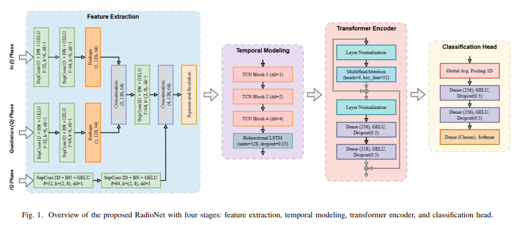
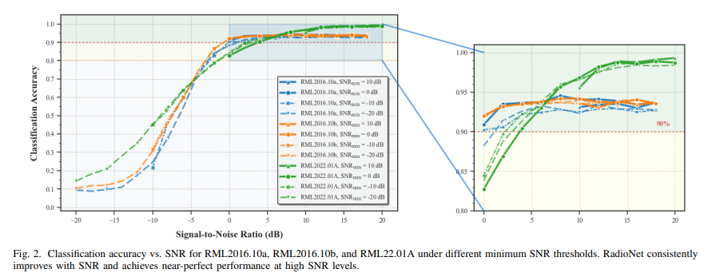
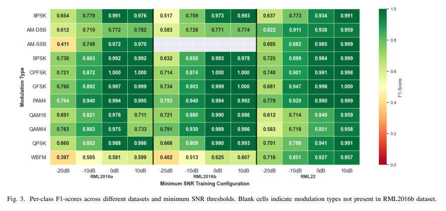

# [Modulation Identification] New Breakthrough in Modulation Identification under Low Signal-to-Noise Ratio! RadioNet Network Achieves Efficient Robust Wireless Signal Classification with Python Code

Low Signal-to-Noise Ratio (SNR) Modulation Identification Breakthrough! RadioNet Network Achieves Efficient Robust Wireless Signal Classification
Article Title: RadioNet: A Multi-Stream Deep Attention Network for Autonomous Modulation Classification in Low SNR
Abstract: Autonomous Modulation Classification (AMC) is a key technology for intelligent wireless receivers to achieve adaptive demodulation and spectrum monitoring. However, under actual channel impairments and low signal-to-noise ratio (SNR) conditions, the performance of traditional Convolutional Neural Networks (CNN) or Recurrent Neural Networks (RNN) in automatic modulation classification still faces challenges. This paper proposes the hybrid architecture RadioNet, which can jointly mine spatial, temporal, and global contextual dependencies from raw I/Q sampling data. The network employs separate convolutions for efficient spatial encoding with IQ, I, and Q three-way synchronous inputs. It combines an Expansion Time Convolutional Network (TCN) stack and a Bidirectional Long Short-Term Memory Network (BiLSTM) to model multi-scale bidirectional sequences, and achieves global context extraction and feature calibration through a Transformer encoder that fuses Squeeze-and-Excitation (SE) channel attention.
Research on Model Evaluation for Multi-Threshold Scenes with Different Signal-to-Noise Ratios (SNR) on RML2016.10a, RML2016.10b, and Real-world Dataset RML22

The study evaluates models for multi-threshold scenes with minimum signal-to-noise ratios of -20, -10, 0, and 10dB on the RML2016.10a, RML2016.10b, and RML22 datasets. The results show that RadioNet exhibits strong robustness in low SNR ranges, with classification accuracy steadily increasing as the minimum SNR is raised. A specialized analysis of modulation types reveals that the network achieves near-maximum recognition performance for common digital modulation methods, but its recognition effectiveness for Quadrature Amplitude Modulation (QAM) is significantly affected by SNR. Additionally, it improves the recognition accuracy of analog modulation on the RML22 dataset. Ablation experiments verify the complementary roles of TCN, BiLSTM, and SE attention modules, finding that the Transformer encoder has the most significant impact on enhancing recognition accuracy under low SNR conditions. RadioNet's competitive recognition accuracy and the efficiency brought by the separable convolution are practical solutions for reliable and real-time automatic modulation classification in various wireless environments.

Automatic Modulation Classification (AMC) plays a central role in modern wireless systems, enabling adaptive demodulation, spectrum monitoring, cognitive radio decision-making, and interference identification without prior knowledge of transmitter information, effectively improving the spectral efficiency and link reliability of civilian and military networks. In ultra-5G/6G scenarios, heterogeneous modulation methods and dynamic spectrum access pose higher requirements for robust and real-time modulation recognition under complex channel conditions, further highlighting the importance of AMC.
The following is the translation of the Chinese text into English without adding any content:
Low Signal-to-Noise Ratio (SNR) Environment: Maintaining High Precision in Autonomous Modulation Classification Still Faces Challenges. In actual wireless channels, noise, fading, Doppler shift, frequency offset, and hardware damage are introduced as interference. Traditional likelihood-based and feature-based methods perform well in controlled environments but lack robustness in practical applications; deep learning techniques have achieved end-to-end feature learning from raw I/Q data. CNN, RNN, and hybrid CNN-RNN models can extract spatial features, capture temporal dependencies, or combine their advantages. However, most existing architectures significantly degrade performance under low SNR conditions, and there is a dependence on a single format input, ignoring multi-scale time and global contextual dependencies.
To address these issues, this paper proposes a Multi-Stream Deep Attention Network, RadioNet, which jointly models spatial, temporal, and contextual information from raw I/Q signals to enhance recognition robustness and computational efficiency under low SNR conditions. The network integrates three streams of separable convolutional neural networks, an Expansion TCN-BiLSTM module, and a Transformer encoder with fused SE attention, achieving efficient multi-scale feature learning. Extensive experiments across different datasets under the same training-test split were conducted to validate the performance and efficiency advantages of RadioNet compared to existing models under low SNR conditions.
Method Overview: RadioNet is a unified multi-stream deep attention architecture. It consists of four stages: feature extraction, temporal modeling, Transformer encoder, and classification head. The core revolves around joint mining of spatial, temporal, and global contextual dependencies from raw I/Q sampling data. The design is detailed as follows:
1. Three-stream Spatial Feature Extraction: Using IQ joint channels, I monochannel, Q monochannel as complementary inputs, respectively employing deep separable convolution layers for processing. The features from I and Q branches are fused together with the IQ branch features through separable convolutions to generate a unified spatial tensor, significantly reducing computation. Meanwhile, an SE module is introduced to adaptively calibrate channel responses through global average pooling and fully connected layers.
2.
Expansion of TCN and BiLSTM for Time Modeling: Reconstruct the calibrated feature tensor into a time series, capturing multi-scale local temporal dependencies through three layers with different expansion rates of TCN modules. The TCN modules employ residual connections to expand the receptive field without increasing depth; subsequent integration with a 128-unit BiLSTM layer learns forward and backward temporal correlations, compensating for phase and frequency drifts caused by the channel, effectively capturing hierarchical temporal features.
3
Transformer Encoder Global Context Modeling: Introduce a lightweight Transformer encoder that includes four self-attention heads and two feedforward networks, capturing long-range feature dependencies and inter-frame relationships at extremely low computational overhead, achieving global context refinement of features.
4
Classification Head: First, perform global average pooling on the sequence features outputted by the Transformer, obtaining compact feature vectors. Then, enhance feature representation through two fully connected layers with GLUELUT activation and dropout, followed by a softmax layer to output the probability distribution of each modulation category.
5
Training Optimization: Use a classification cross-entropy loss function with L2 weight decay, and implement the AdamW optimizer to achieve decoupling between weight decay and adaptive moment estimation, enhancing model generalization capability. The model is implemented in the TensorFlow framework, training based on a hierarchical dataset division, incorporating learning rate scheduling, early stopping, and model checkpoints strategies to avoid overfitting while preserving optimal parameters.
Conclusion: This paper proposes the RadioNet multi-stream deep attention network, integrating separable convolutional blocks, augmented TCN, BiLSTM, and Transformer encoders to achieve robust automatic modulation classification in low signal-to-noise ratio environments. Comprehensive evaluation on multiple benchmark datasets demonstrates that RadioNet exhibits superior performance across different signal-to-noise ratio ranges, demonstrating strong interference resistance and steady improvement in classification accuracy with improved signal quality. Ablation experiments validate the complementary roles of each network component, with the Transformer encoder playing a key role in enhancing performance under low signal-to-noise ratio conditions.
Special analysis on modulation types shows that RadioNet has excellent recognition capabilities for digital modulation methods, but its performance in QAM modulation is significantly affected by the signal-to-noise ratio. Analog modulation remains a challenge, achieving significant improvements in recognition accuracy for WBFM and other analog modulations only on the more realistic RML22 dataset.
Future research will focus on three areas: developing lightweight variants of RadioNet for embedded and edge device deployment; extending the network to multi-antenna MIMO scenarios; and introducing semi-supervised or contrastive pretraining methods for modulation classification with unlabeled data. Additionally, incorporating cross-domain adaptive and federated learning techniques will further enhance the model's generalization capability and scalability in dynamic 6G wireless environments.

## Images

<!-- PAYMENT_BLOCK -->

## Get this dataset

- Payment link (Stripe): [Buy now](https://buy.stripe.com/3cs8yP7sY87d0vu9AB)
- Payment QR code: 

<!-- /PAYMENT_BLOCK -->
